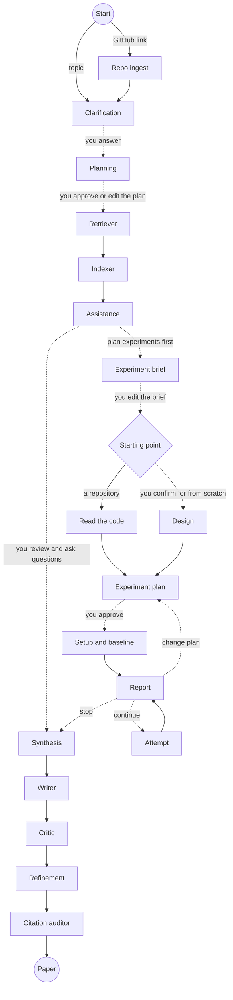

# Lume.ai: Autonomous Research Agent for Computer Science

**Lume** takes a research idea from question to paper. It scopes the question with you, plans the paper, searches Semantic Scholar, arXiv, OpenAlex, CORE, the web and your own PDFs, and then writes an IEEE-style draft. Every citation points to a source it actually retrieved. Built with **LangGraph**, **FastAPI** and **Next.js**.

Lume is built for computer-science researchers first. It can also **run experiments**: a coding agent starts from existing code (a repository you name, or open-source code it finds) or writes it from scratch, runs attempts in an isolated CPU sandbox, reports to you after every attempt, and puts the measured results into the paper.


## Features

### Research projects
A multi-agent pipeline with checkpoints where you stay in control:

1. **Clarify:** Lume asks a few questions to pin down scope, baselines and what counts as a result.
2. **Plan:** you review the research plan, edit, add or remove sections, and approve it before anything is searched.
3. **Gather sources:** parallel searches across Semantic Scholar, arXiv, OpenAlex, CORE, the web (Tavily) and your private library. The top sources are read in full and indexed in Qdrant. When a publisher refuses (403), Lume tries other legal routes to the same paper before falling back to its abstract: the arXiv PDF, an open-access PDF from Semantic Scholar or OpenAlex, Unpaywall (with `CONTACT_EMAIL`), then Tavily Extract. A page under 3,000 characters doesn't count as the full text.
4. **Review:** read a summary and ask questions about the sources before Lume writes.
5. **Write and verify:**
   - Each section is written from evidence passages labelled with their reference numbers.
   - A critic reviews the draft and an editor polishes it.
   - A citation check confirms every `[n]` maps to a retrieved source.

Choose the **length** (Auto, or 1–15 IEEE pages: Lume plans more sections and writes longer ones to fit), and **Quick** (15+ sources) or **Deep research** (50+ sources), **Stop** at any time and **resume** later from History.

### Papers from your GitHub repository
Paste a public GitHub link and Lume writes a paper about *your* project:

1. **Read the repository:** Lume downloads it through the GitHub API (in memory; nothing from it is ever run), reads the README, dependency files, source and notebooks, and indexes the code.
2. **Project summary:** you see what Lume understood (what the project does, its components, tech stack and any results in the repo) before anything is written.
3. **Questions only you can answer:** the course or venue, your contribution, results measured outside the repo.
4. **Related work:** the usual search, seeded with queries derived from the code.
5. **Write:** the repository is reference [1]. Claims about the project cite its code, and claims about the field cite the literature. Lume never invents results; if the repo has none, the paper describes how the project would be evaluated.

### IEEE-style papers
- The paper is typeset IEEE-style: two columns, an *Abstract*— block, *Index Terms*—, and sections numbered I, II, III with subsections A, B.
- References list only cited works, numbered by first citation, in IEEE format, e.g. `A. Author et al., "Title," arXiv, 2026. [Online]. Available: …`.
- Export as **PDF** (via the browser's print engine, with real selectable text), **LaTeX** using the official `IEEEtran` class (ready for Overleaf), or **Markdown**.

### Ask about your sources (hybrid RAG)
The review step's chat uses a full retrieval pipeline:
- **Query rewriting** from the conversation and research summary, so "how did *they* achieve 99%?" becomes a precise, standalone query.
- **Hybrid search:** dense vectors (Qdrant) plus BM25 keyword search over every indexed passage and every source abstract, merged with Reciprocal Rank Fusion.
- **LLM reranking:** the best passages win, with at most two per source.
- Answers cite `[n]` with linked sources and show the query that was searched.

### Brainstorm with live search
A chat for exploring ideas before committing to a project:
- The model decides when to search the **web**, **arXiv** (with a newest-first option) or **OpenAlex**.
- You see each search live ("Searching arXiv for …"), followed by its sources.
- Answers cite `[n]` with links. Conversations, searches and sources are saved to History.

### Experiments (coding agent, local CPU sandbox)
After the sources are reviewed, choose **Plan experiments first** instead of writing the draft straight away.
- **Brief:** Lume drafts the objective, metric, checks that must still pass and what must not change; you edit it.
- **Starting point:** a repository you name, or existing open-source code Lume finds (you confirm before it is read), or code written from scratch when nothing fits.
- **Plan:** Lume reads the code (a tree-sitter code graph, not embeddings) and proposes setup, build, checks, the measure command, protected files and ranked ideas, checked against the project's issues and pull requests and the literature. Setup is the only step with network, so it also fetches models and data the benchmark needs. Nothing runs until you approve, and you can edit every field. The plan screen shows each tool call the agent made.
- **Agent tools:** repo map, outline, find definition and references, ripgrep search, file reads, literature and GitHub search, and `ask_user` when only you can answer. Each phase has a turn limit; near it the agent is told to answer, and if it still runs out it answers from what it found instead of losing the work.
- **Attempts:** each one edits code in a Docker sandbox with no network, then a fresh sandbox grades it: build, checks, then repeated measurements (hyperfine for timings). After every attempt you see a report and decide: continue, change the plan (your note reaches the agent), or stop. A failed command reports its own error, and exit codes 126/127 are spelled out (not executable, command not found).
- **Honest results:** improving existing code is compared with its baseline; code written from scratch shows a results table (variant × metric, mean ± spread), with the evaluation written first and frozen once you review it. Protected files can't be changed, and failures are reported too.
- **Download:** the code as a zip with `LUME_RUN.md` (how to reproduce it) and, for existing code, `changes.diff`. The paper is written from the measured results.

### Workspace
- **Live progress:** the current agent with an elapsed timer, real progress messages ("Writing section 3 of 6: …"), the paper streaming as it's written, and a readable activity log.
- **Private library:** upload PDFs, which are searched alongside public sources in every project.
- **History:** every research project and brainstorm is saved and reopens where you left off. Sessions are persisted with LangGraph's Postgres checkpointer.
- **Resilience:** transient LLM failures (dropped streams, 5xx errors, rate limits) are retried automatically, and Qdrant writes go in batches that are retried on connection resets and timeouts. A stopped or failed run shows the step it continues from and reruns only that step.

## Roadmap

| Status | Capability |
|---|---|
| Next | **Grounded citations:** check that each cited passage actually supports its sentence; click a citation to see the exact passage; move the paper writer onto hybrid retrieval |
| In progress | **Experiments:** the CPU coding agent above runs locally in Docker. Next: starting-point cards with stars, license and activity, several repositories per experiment, figures from runs, and a cloud GPU sandbox for training |
| Planned | **More autonomy:** gap-driven re-search, parallel section writers, critic-driven revision loops, budget limits |
| Planned | **Judge model:** a probabilistic verifier for citation checks, reranking and rubric-based critique |

The landing page marks Experiments and claim-level Verification as **Early access** until they ship.

## Architecture

### Research pipeline (LangGraph)

The dotted edges are human-in-the-loop pauses (`interrupt_after`). The run is checkpointed after every step, so it can be stopped and continued.

### Streaming
The backend streams Server-Sent Events:
- `agent_start`, `progress`, `thought` (streamed prose from the writing agents), `step`, `interrupt`, `done` and `error`;
- for brainstorm, also `search_start` and `search_end`.

### Brainstorm agent
A small agent loop (`graph/brainstorm.py`): the model either answers or calls search tools, the tools node runs the searches in parallel, and the loop is capped at 3 search rounds per message. It shares the Postgres checkpointer, so chats persist.

## Tech stack

**Backend:** FastAPI, LangGraph, LangChain, Qdrant, Supabase (Auth, Postgres), Tavily, arXiv, OpenAlex and CORE APIs, Jina Reader (full text), OpenRouter or Groq for LLMs and OpenRouter for embeddings.

**Frontend:** Next.js 14 (App Router, TypeScript), Tailwind CSS, Framer Motion, react-markdown, Supabase JS.

**Design:** Mistral beige `#F5F2ED`, black `#000000`, orange `#FF511C`. EB Garamond for headings, Space Grotesk for the interface, IBM Plex Mono for technical labels. Sharp corners, readable sizes (nothing below 12px).

## Project structure

```text
├── backend/
│   ├── agents/          # one module per graph node (clarification … auditor, repo_ingest),
│   │                    # project_context, brainstorm prompt, search tools
│   ├── repo/            # repository ingestion: github (provider), filetypes, scanner,
│   │                    # profiler (LLM project profile), indexing (code chunks → Qdrant)
│   ├── evidence/        # passages the writer cites: literature + project code (next: experiment runs)
│   ├── experiments/     # coding agent: brief, lab state, prompts, agent runtime and tools,
│   │                    # harness (build, checks, measure), notebook, git workspace, zip package
│   ├── codegraph/       # tree-sitter code graph and PageRank repo map
│   ├── sandbox/         # Docker sandbox (no network after setup, capped resources) + Dockerfile
│   ├── api/
│   │   ├── main.py      # app, lifespan (Postgres checkpointer), routers
│   │   └── routers/     # research, chat (RAG), brainstorm, library, sessions
│   ├── graph/           # workflow.py (research graph), brainstorm.py (search agent)
│   ├── utils/           # llm (routing, retries), rag (hybrid retrieval), vectorstore,
│   │                    # auth, ingestion, scraper, events
│   ├── tests/           # pytest suite (offline: fakes for LLMs, search and storage)
│   ├── requirements.txt
│   └── requirements-dev.txt
├── frontend/
│   └── src/
│       ├── app/         # landing page, /dashboard
│       ├── components/  # landing/ and dashboard/ (stages, panels, search activity)
│       └── lib/         # api client, types, IEEE typesetting and LaTeX export, Supabase
└── supabase_schema.sql  # profiles, projects, sessions, library (+ RLS)
```

### API

| Method | Endpoint | Purpose |
|---|---|---|
| POST | `/api/research/start` | Start a research project from a `topic` or a `repo_url`, with optional `pages` (SSE) |
| POST | `/api/research/resume` | Answer questions, approve or edit the plan, continue; for experiments: choose the starting point, approve the plan, retry it, decide after a report, answer the agent's question (SSE) |
| PUT | `/api/research/{thread_id}/brief` | Save an edited experiment brief |
| GET | `/api/research/{thread_id}/code` | Download the experiment code as a zip |
| GET | `/api/research/{thread_id}` | Restore a saved session |
| POST | `/api/research/chat` | Ask about a session's sources (hybrid RAG) |
| POST | `/api/research/brainstorm` | Brainstorm message with live search (SSE) |
| GET | `/api/research/brainstorm/{chat_id}` | Restore a brainstorm conversation |
| GET | `/api/sessions` | Research and brainstorm history |
| DELETE | `/api/sessions/{thread_id}` | Delete a project or brainstorm: its saved state, indexed sources and History entry |
| POST / GET | `/api/library/upload`, `/api/library` | Private PDF library |

All endpoints require a Supabase access token (`Authorization: Bearer …`).

## Setup

### 1. Prerequisites
- Python 3.10+ and Node.js 18+
- Optional, for experiments: [Docker Desktop](https://www.docker.com/products/docker-desktop/). The sandbox defaults (5 cores, 4 GB per run) fit Docker Desktop set to 6 CPUs and 6 GB; change them with `SANDBOX_CPUS` and `SANDBOX_MEMORY`
- A [Supabase](https://supabase.com/) project (Auth and Postgres)
- A [Qdrant](https://qdrant.tech/) instance (local or cloud)
- API keys: [OpenRouter](https://openrouter.ai/) and [Tavily](https://tavily.com/). OpenAlex and [CORE](https://core.ac.uk/services/api) keys are optional, and Groq is optional.

### 2. Database
Run `supabase_schema.sql` in the Supabase SQL editor. LangGraph creates its checkpoint tables automatically on first start.

### 3. Backend
```bash
python -m venv venv
source venv/bin/activate
pip install -r backend/requirements-dev.txt

cp backend/.env.example backend/.env   # then fill in your keys
cd backend
uvicorn api.main:app --reload          # http://127.0.0.1:8000
```

Key variables in `backend/.env`:

| Variable | Purpose |
|---|---|
| `OPENROUTER_API_KEY` | LLMs and embeddings |
| `TAVILY_API_KEY` | Web search |
| `OPENALEX_API_KEY`, `CORE_API_KEY` | Optional: academic search (CORE is skipped without a key) |
| `CONTACT_EMAIL` | Recommended: OpenAlex's polite pool, and Unpaywall (finds legal free copies of paywalled papers; skipped without it) |
| `SEMANTIC_SCHOLAR_API_KEY` | Recommended: Semantic Scholar finds well-known papers best, but anonymous access is usually rate limited. Without a key, Lume skips it for 10 minutes after it refuses. [Get a free key](https://www.semanticscholar.org/product/api#api-key-form) |
| `DATABASE_URL` | Supabase Postgres, used by the LangGraph checkpointer |
| `SUPABASE_URL`, `SUPABASE_SERVICE_ROLE_KEY` | Auth checks, sessions and library tables |
| `QDRANT_URL`, `QDRANT_API_KEY` | Vector store |
| `GITHUB_TOKEN` | Optional: raises GitHub's API limit from 60 to 5,000 requests an hour for repository papers |
| `DEFAULT_MODEL` and `*_MODEL` | Model per agent (see below) |
| `EMBEDDING_MODEL` | Embedding model; the vector size is detected automatically |
| `EXPERIMENT_MODEL`, `CODING_MODEL` | Coding agent: reading code, planning and reports, and the code edits (must support tool calling) |
| `SANDBOX_CPUS`, `SANDBOX_MEMORY`, `LUME_WORKSPACES` | Optional: sandbox limits (default 5 cores, 4 GB) and where target code is cloned |

**Choosing models:**
- Each agent reads its own variable: `CLARIFICATION_MODEL`, `PLANNING_MODEL`, `RETRIEVAL_MODEL` (also used for query rewriting and reranking), `ASSISTANCE_MODEL`, `SYNTHESIS_MODEL`, `WRITING_MODEL`, `CRITIC_MODEL`, `REFINEMENT_MODEL`, `BRAINSTORM_MODEL` (must support tool calling), `CHAT_MODEL` and `REPO_ANALYSIS_MODEL` (reads ~30K characters of code; use a strong model).
- An agent with no variable set falls back to `DEFAULT_MODEL`.
- IDs like `openai/gpt-5.4-mini` route to OpenRouter. Prefix with `groq:` (e.g. `groq:openai/gpt-oss-120b`) to use Groq.

### 4. Frontend
```bash
cd frontend
npm install
npm run dev   # http://localhost:3000
```

`frontend/.env.local`:
```env
NEXT_PUBLIC_SUPABASE_URL=https://[PROJECT].supabase.co
NEXT_PUBLIC_SUPABASE_PUBLISHABLE_KEY=your_publishable_key
# Optional, defaults to http://127.0.0.1:8000
NEXT_PUBLIC_API_URL=http://127.0.0.1:8000
```

### 5. Experiment sandbox (optional)
Generated code never runs in the backend process. It runs in Docker containers with no network, capped CPU,
memory and processes, a read-only system, an unprivileged user and a timeout on every command. Build the
base image once (about 800 MB: compilers, Python, git, hyperfine, ripgrep):
```bash
docker build -t lume-sandbox:base backend/sandbox
```
Target workspaces are cloned to `~/.lume/workspaces` (override with `LUME_WORKSPACES`).

### 6. Tests
```bash
cd backend
../venv/bin/python -m pytest tests
```
The suite runs offline. LLMs, search APIs, Qdrant and Supabase are replaced with fakes, so no keys are used.
One sandbox test runs real containers when Docker is running and the base image is built; it is skipped otherwise.

## Troubleshooting
- **IPv6-only database host:** Supabase's direct `db.<project>.supabase.co` host is IPv6-only. Many hosting platforms can't reach it; use the **connection pooler** URL from *Database → Connect* for `DATABASE_URL` when deploying.
- **"violates foreign key constraint sessions_user_id_fkey":** this happens to accounts created before the profile trigger existed. The backend now creates missing profiles automatically. To backfill existing ones, run:
  ```sql
  insert into public.profiles (id, email, full_name)
  select id, email, raw_user_meta_data->>'full_name' from auth.users
  on conflict (id) do nothing;
  ```
- **Repository analysis comes back generic:** the profile fell back to the repo's name and description because the model's JSON was cut off. Reasoning models spend part of their output budget on thinking, so set `REPO_ANALYSIS_MODEL` to a strong non-reasoning model.
- **Experiment plan stays disabled ("Add at least one idea and a measure command"):** approval needs at least one idea and a measure command. If reading the code ended without them, press **Try again**, or fill the fields yourself: the measure is a shell command (e.g. `./build/bench --model m.gguf`), not a description. Keep the brief to one metric the code can print.
- **Baseline failed with exit code 127:** a program in the build, check or measure command doesn't exist in the sandbox. The report quotes the command. Add what it needs to Setup, or fix the command.
- **Changed `EMBEDDING_MODEL`:** existing Qdrant collections keep their old vector size. Delete them, or switch back to the original model.

## License
MIT
