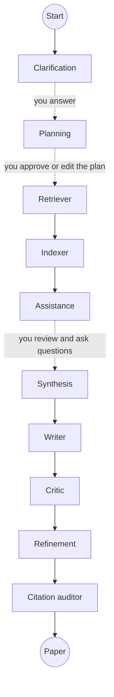

# Lume.ai: Autonomous Research Agent for Computer Science

**Lume** takes a research idea from question to paper. It scopes the question with you, plans the paper, searches arXiv, OpenAlex, CORE, the web and your own PDFs, and then writes an IEEE-style draft. Every citation points to a source it actually retrieved. Built with **LangGraph**, **FastAPI** and **Next.js**.

Lume is built for computer-science researchers first. The next major capability on the roadmap is **running experiments**: the agent writes the code, runs it in an isolated sandbox and puts the real results and figures into the paper.


## Features

### Research projects
A multi-agent pipeline with checkpoints where you stay in control:

1. **Clarify:** Lume asks a few questions to pin down scope, baselines and what counts as a result.
2. **Plan:** you review the research plan, edit, add or remove sections, and approve it before anything is searched.
3. **Gather sources:** parallel searches across arXiv, OpenAlex, CORE, the web (Tavily) and your private library. The top sources are read in full and indexed in Qdrant.
4. **Review:** read a summary and ask questions about the sources before Lume writes.
5. **Write and verify:**
   - Each section is written from evidence passages labelled with their reference numbers.
   - A critic reviews the draft and an editor polishes it.
   - A citation check confirms every `[n]` maps to a retrieved source.

You can **Quick** (15+ sources) or **Deep research** (50+ sources), **Stop** at any time and **resume** later from History.

### IEEE-style papers
- The paper is typeset IEEE-style: two columns, an *Abstract*— block, *Index Terms*—, and sections numbered I, II, III with subsections A, B.
- References list only cited works, numbered by first citation, in IEEE format, e.g. `A. Author et al., "Title," arXiv, 2026. [Online]. Available: …`.
- Export as **PDF** (via the browser's print engine, with real selectable text), **LaTeX** using the official `IEEEtran` class (ready for Overleaf), or **Markdown**.

### Ask about your sources (hybrid RAG)
The review step's chat uses a full retrieval pipeline:
- **Query rewriting** from the conversation and research summary, so "how did *they* achieve 99%?" becomes a precise, standalone query.
- **Hybrid search:** dense vectors (Qdrant) plus BM25 keyword search over every indexed passage and every source abstract, merged with Reciprocal Rank Fusion.
- **LLM reranking:** the best passages win, with at most two per source.
- Answers cite `[n]` with linked sources and show the query that was searched.

### Brainstorm with live search
A chat for exploring ideas before committing to a project:
- The model decides when to search the **web**, **arXiv** (with a newest-first option) or **OpenAlex**.
- You see each search live ("Searching arXiv for …"), followed by its sources.
- Answers cite `[n]` with links. Conversations, searches and sources are saved to History.

### Workspace
- **Live progress:** the current agent with an elapsed timer, real progress messages ("Writing section 3 of 6: …"), the paper streaming as it's written, and a readable activity log.
- **Private library:** upload PDFs, which are searched alongside public sources in every project.
- **History:** every research project and brainstorm is saved and reopens where you left off. Sessions are persisted with LangGraph's Postgres checkpointer.
- **Resilience:** transient LLM failures (dropped streams, 5xx errors, rate limits) are retried automatically.

## Roadmap

| Status | Capability |
|---|---|
| Next | **Grounded citations:** check that each cited passage actually supports its sentence; click a citation to see the exact passage; move the paper writer onto hybrid retrieval |
| Planned | **Experiment sandbox:** the agent writes and runs experiment code in an isolated sandbox (GPU-capable for training), with hypotheses and metrics approved up front, several seeds, and figures and results cited as runs |
| Planned | **More autonomy:** gap-driven re-search, parallel section writers, critic-driven revision loops, budget limits |
| Planned | **Judge model:** a probabilistic verifier for citation checks, reranking and rubric-based critique |

The landing page marks Experiments and claim-level Verification as **Early access** until they ship.

## Architecture

### Research pipeline (LangGraph)

The dotted edges are human-in-the-loop pauses (`interrupt_after`). The run is checkpointed after every step, so it can be stopped and continued.

### Streaming
The backend streams Server-Sent Events:
- `agent_start`, `progress`, `thought` (streamed prose from the writing agents), `step`, `interrupt`, `done` and `error`;
- for brainstorm, also `search_start` and `search_end`.

### Brainstorm agent
A small agent loop (`graph/brainstorm.py`): the model either answers or calls search tools, the tools node runs the searches in parallel, and the loop is capped at 3 search rounds per message. It shares the Postgres checkpointer, so chats persist.

## Tech stack

**Backend:** FastAPI, LangGraph, LangChain, Qdrant, Supabase (Auth, Postgres), Tavily, arXiv, OpenAlex and CORE APIs, Jina Reader (full text), OpenRouter or Groq for LLMs and OpenRouter for embeddings.

**Frontend:** Next.js 14 (App Router, TypeScript), Tailwind CSS, Framer Motion, react-markdown, Supabase JS.

**Design:** Mistral beige `#F5F2ED`, black `#000000`, orange `#FF511C`. EB Garamond for headings, Space Grotesk for the interface, IBM Plex Mono for technical labels. Sharp corners, readable sizes (nothing below 12px).

## Project structure

```text
├── backend/
│   ├── agents/          # clarification, planning, retriever, indexer, assistance, synthesis,
│   │                    # writer, critic, refinement, auditor, brainstorm prompt, search tools
│   ├── api/
│   │   ├── main.py      # app, lifespan (Postgres checkpointer), routers
│   │   └── routers/     # research, chat (RAG), brainstorm, library, sessions
│   ├── graph/           # workflow.py (research graph), brainstorm.py (search agent)
│   ├── utils/           # llm (routing, retries), rag (hybrid retrieval), vectorstore,
│   │                    # auth, ingestion, scraper, events
│   ├── tests/           # pytest suite (offline: fakes for LLMs, search and storage)
│   ├── requirements.txt
│   └── requirements-dev.txt
├── frontend/
│   └── src/
│       ├── app/         # landing page, /dashboard
│       ├── components/  # landing/ and dashboard/ (stages, panels, search activity)
│       └── lib/         # api client, types, IEEE typesetting and LaTeX export, Supabase
└── supabase_schema.sql  # profiles, projects, sessions, library (+ RLS)
```

### API

| Method | Endpoint | Purpose |
|---|---|---|
| POST | `/api/research/start` | Start a research project (SSE) |
| POST | `/api/research/resume` | Answer questions, approve or edit the plan, or continue (SSE) |
| GET | `/api/research/{thread_id}` | Restore a saved session |
| POST | `/api/research/chat` | Ask about a session's sources (hybrid RAG) |
| POST | `/api/research/brainstorm` | Brainstorm message with live search (SSE) |
| GET | `/api/research/brainstorm/{chat_id}` | Restore a brainstorm conversation |
| GET | `/api/sessions` | Research and brainstorm history |
| POST / GET | `/api/library/upload`, `/api/library` | Private PDF library |

All endpoints require a Supabase access token (`Authorization: Bearer …`).

## Setup

### 1. Prerequisites
- Python 3.10+ and Node.js 18+
- A [Supabase](https://supabase.com/) project (Auth and Postgres)
- A [Qdrant](https://qdrant.tech/) instance (local or cloud)
- API keys: [OpenRouter](https://openrouter.ai/) and [Tavily](https://tavily.com/). OpenAlex and [CORE](https://core.ac.uk/services/api) keys are optional, and Groq is optional.

### 2. Database
Run `supabase_schema.sql` in the Supabase SQL editor. LangGraph creates its checkpoint tables automatically on first start.

### 3. Backend
```bash
python -m venv venv
source venv/bin/activate
pip install -r backend/requirements-dev.txt

cp backend/.env.example backend/.env   # then fill in your keys
cd backend
uvicorn api.main:app --reload          # http://127.0.0.1:8000
```

Key variables in `backend/.env`:

| Variable | Purpose |
|---|---|
| `OPENROUTER_API_KEY` | LLMs and embeddings |
| `TAVILY_API_KEY` | Web search |
| `OPENALEX_API_KEY`, `CORE_API_KEY`, `CONTACT_EMAIL` | Optional: academic search (CORE is skipped without a key) |
| `DATABASE_URL` | Supabase Postgres, used by the LangGraph checkpointer |
| `SUPABASE_URL`, `SUPABASE_SERVICE_ROLE_KEY` | Auth checks, sessions and library tables |
| `QDRANT_URL`, `QDRANT_API_KEY` | Vector store |
| `DEFAULT_MODEL` and `*_MODEL` | Model per agent (see below) |
| `EMBEDDING_MODEL` | Embedding model; the vector size is detected automatically |

**Choosing models:**
- Each agent reads its own variable: `CLARIFICATION_MODEL`, `PLANNING_MODEL`, `RETRIEVAL_MODEL` (also used for query rewriting and reranking), `ASSISTANCE_MODEL`, `SYNTHESIS_MODEL`, `WRITING_MODEL`, `CRITIC_MODEL`, `REFINEMENT_MODEL`, `BRAINSTORM_MODEL` (must support tool calling) and `CHAT_MODEL`.
- An agent with no variable set falls back to `DEFAULT_MODEL`.
- IDs like `openai/gpt-5.4-mini` route to OpenRouter. Prefix with `groq:` (e.g. `groq:openai/gpt-oss-120b`) to use Groq.

### 4. Frontend
```bash
cd frontend
npm install
npm run dev   # http://localhost:3000
```

`frontend/.env.local`:
```env
NEXT_PUBLIC_SUPABASE_URL=https://[PROJECT].supabase.co
NEXT_PUBLIC_SUPABASE_PUBLISHABLE_KEY=your_publishable_key
# Optional, defaults to http://127.0.0.1:8000
NEXT_PUBLIC_API_URL=http://127.0.0.1:8000
```

### 5. Tests
```bash
cd backend
../venv/bin/python -m pytest tests
```
The suite runs offline. LLMs, search APIs, Qdrant and Supabase are replaced with fakes, so no keys are used.

## Troubleshooting
- **IPv6-only database host:** Supabase's direct `db.<project>.supabase.co` host is IPv6-only. Many hosting platforms can't reach it; use the **connection pooler** URL from *Database → Connect* for `DATABASE_URL` when deploying.
- **"violates foreign key constraint sessions_user_id_fkey":** this happens to accounts created before the profile trigger existed. The backend now creates missing profiles automatically. To backfill existing ones, run:
  ```sql
  insert into public.profiles (id, email, full_name)
  select id, email, raw_user_meta_data->>'full_name' from auth.users
  on conflict (id) do nothing;
  ```
- **Changed `EMBEDDING_MODEL`:** existing Qdrant collections keep their old vector size. Delete them, or switch back to the original model.

## License
MIT
